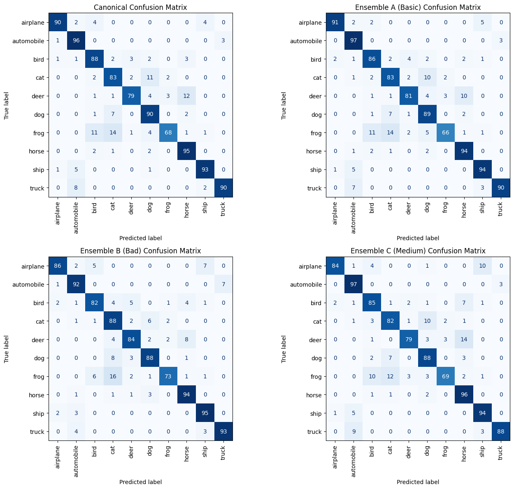
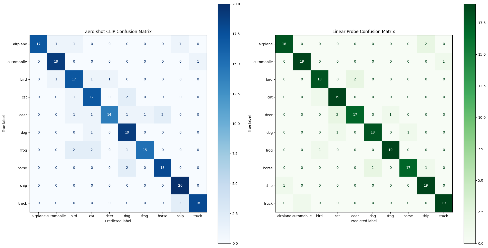
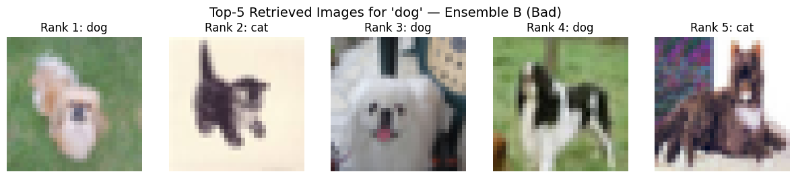

# CLIP Prompt Robustness

### Does prompt wording change what CLIP retrieves on CIFAR-10?

**Samik Hafeez · Year 3 individual project · Advanced AI Methods and Tools · 2025–2026, Semester 1**

A notebook-based experiment on a frozen vision-language model. The same ten CIFAR-10 class names are worded four ways (a canonical prompt, natural rewordings, deliberately misleading descriptions and degraded-image descriptions) and scored against one fixed 1,000-image gallery. A linear probe on the same CLIP image embeddings provides a supervised comparison, and a Gradio app lets the model be tested by hand.

[Original notebook](notebooks/clip_prompt_robustness.ipynb) · [Set-up](#experimental-set-up) · [Saved results](#saved-results) · [Reading the results](#reading-the-results) · [Reproduction notes](docs/REPRODUCIBILITY.md)

---

## Project at a glance

| Area | Work represented in the source |
| :--- | :--- |
| Model | `openai/clip-vit-base-patch32` from Hugging Face Transformers, frozen, run on CPU |
| Data | CIFAR-10 test split; a fixed gallery of 100 images per class (1,000 images), NumPy seed 0 |
| Prompt conditions | Canonical prompt plus three five-template ensembles (A, B and C), averaged per class |
| Measurements | Text-to-image Recall@1 and Recall@5, zero-shot classification accuracy, macro and weighted F1, top-5 accuracy, confusion matrices |
| Supervised comparison | Logistic-regression linear probe on the CLIP image embeddings, 80 training and 20 test images per class |
| Demonstration | Gradio app with four tools, launched from Google Colab |

## Experimental set-up

```mermaid
flowchart TD
    A[CIFAR-10 test split] --> B[Fixed gallery: 100 images per class, seed 0]
    B --> C[CLIP image encoder, frozen]
    C --> D[1,000 x 512 image embeddings]
    E[Ten class names] --> F[Four prompt conditions]
    F --> G[CLIP text encoder, templates averaged per class]
    G --> H[10 x 512 class embeddings per condition]
    D --> I[Cosine similarity and ranking]
    H --> I
    I --> J[Recall@1 and Recall@5 for ten class-name queries]
    I --> K[Zero-shot classification of all 1,000 images]
    D --> L[Linear probe: 800 train, 200 test]
    classDef data fill:#e0f2fe,stroke:#0284c7,color:#0c4a6e
    classDef model fill:#ede9fe,stroke:#7c3aed,color:#4c1d95
    classDef evidence fill:#dcfce7,stroke:#16a34a,color:#14532d
    class A,B,E data
    class C,D,F,G,H model
    class I,J,K,L evidence
```

The image embeddings are computed once and reused, so differences between conditions come from the text side only.

### Prompt conditions

`{label}` is the class name. Each ensemble's five prompts are encoded and averaged into one embedding per class.

| Condition | Templates |
| :--- | :--- |
| Canonical | a photo of a {label} |
| Ensemble A (natural) | a photo of a {label} · a picture of a {label} · an image of a {label} · a close-up photo of a {label} · a bright photo of a {label} |
| Ensemble B (misleading) | a random object unrelated to a {label} · an incorrect depiction of a {label} · a distorted sculpture not resembling a {label} · a photo of something different instead of a {label} · an abstract wrong representation of a {label} |
| Ensemble C (degraded) | a blurry photo of a {label} · a low resolution image of a {label} · a {label} partially hidden behind objects · an overexposed photo of a {label} · a small {label} in the distance |

## Saved results

The values below are transcribed from the notebook's stored outputs. The notebook was not rerun for this repository.

### Retrieval

Recall@1 and Recall@5 were **1.0 for every condition**, and the Prompt Efficiency Index was therefore 0. Each of the ten class-name queries placed an image of the correct class first.

### Zero-shot classification of the 1,000 gallery images

From notebook cell 34:

| Condition | Accuracy | Macro F1 | Top-5 accuracy | Correct images |
| :--- | ---: | ---: | ---: | ---: |
| Canonical | 87.2% | 0.871 | 99.3% | 872 |
| Ensemble A (natural) | 87.1% | 0.870 | 99.5% | 871 |
| Ensemble B (misleading) | 87.5% | 0.875 | 99.5% | 875 |
| Ensemble C (degraded) | 86.2% | 0.861 | 99.3% | 862 |

Correct predictions per class, out of 100, read from the diagonals of the stored confusion matrices:

| Class | Canonical | A | B | C |
| :--- | ---: | ---: | ---: | ---: |
| airplane | 90 | 91 | 86 | 84 |
| automobile | 96 | 97 | 92 | 97 |
| bird | 88 | 86 | 82 | 85 |
| cat | 83 | 83 | 88 | 82 |
| deer | 79 | 81 | 84 | 79 |
| dog | 90 | 89 | 88 | 88 |
| frog | 68 | 66 | 73 | 69 |
| horse | 95 | 94 | 94 | 96 |
| ship | 93 | 94 | 95 | 94 |
| truck | 90 | 90 | 93 | 88 |



*Extracted from the stored output of notebook cell 34; not regenerated.*

### Zero-shot against a linear probe

From notebook cell 24, on the same 200 held-out images (20 per class):

| Method | Accuracy | Correct images |
| :--- | ---: | ---: |
| Linear probe (logistic regression on CLIP image embeddings, 800 training images) | 91.5% | 183 of 200 |
| Zero-shot CLIP (canonical prompts, no training) | 87.0% | 174 of 200 |



*Extracted from the stored output of notebook cell 25; not regenerated.*

### Retrieved images

The notebook stores the top five gallery images for every class under each ensemble: 150 images in total, of which 147 are the correct class. The three exceptions are two cats returned for “dog” under Ensemble B and one dog returned for “cat” under Ensemble C.



*Extracted from the stored output of notebook cell 16; not regenerated.* Other extracted figures: [the cat query under Ensemble C](assets/retrieval-cat-ensemble-c.png), [the canonical zero-shot confusion matrix](assets/zero-shot-confusion-matrix.png), [per-class F1](assets/per-class-f1-by-condition.png) and [accuracy by condition](assets/accuracy-by-condition.png). Their provenance is recorded in [provenance.json](assets/provenance.json).

## Reading the results

- **The retrieval metric was saturated.** The notebook's Recall@K checks whether any image of the queried class appears in the top K (a hit-at-K measure) for ten queries. Every condition scored 1.0, so the metric cannot distinguish them. Precision@K or mean average precision over all 100 relevant images would be more informative.
- **Overall differences are small.** The four conditions span 13 images out of 1,000. The misleading ensemble scored highest, by 3 images over the canonical prompt; that is too small a difference to rank the conditions. Every misleading template still contains the class name, which may explain the result; this was not tested.
- **Ensemble averages were not re-normalised.** In classification, this gives classes whose five prompts agree more closely a slight advantage, independent of wording quality. Its size was not measured and could be comparable to the differences above. Retrieval rankings are unaffected.
- **Per-class results moved more than the totals.** Ensemble B gained on frog, deer and cat and lost on airplane, bird and automobile. The images are the same in every condition, so the wording caused these shifts, but they come from one sample of 100 images per class.
- **Some errors persist under every wording.** Frog was the weakest class in all four conditions, and cat–dog and deer–horse confusions appear throughout. At 32 × 32 pixels (upscaled to 224 × 224), these animals are hard to separate.
- **The supervised probe was stronger.** It classified 9 more of the 200 held-out images correctly, gaining most on frog and deer, but it needed 800 labelled examples; zero-shot needed none.

The written report's abstract describes the prompt effect as strong. The stored outputs support the more limited reading above.

## Gradio demonstration

Notebook cell 33 builds a Gradio app with four tools:

| Tool | What it does |
| :--- | :--- |
| Image → text similarity | Scores an uploaded image against comma-separated prompts |
| Text → image | Returns the most similar CIFAR-10 gallery image for a prompt |
| Zero-shot top five | Lists the five most likely CIFAR-10 classes for an uploaded image |
| Ensemble A/B/C evaluation | Shows the class each prompt ensemble predicts for the same image |

It was launched from Colab through a temporary share link, which has expired. It has not been deployed.

## Run locally

The notebook was executed on Google Colab (Python 3.12, CPU). No environment lockfile was saved. `requirements.txt` is a proposed compatibility set assembled from the notebook's imports and stored warnings; it has not been installed or tested for this repository.

```bash
python3.12 -m venv .venv
source .venv/bin/activate
python -m pip install -r requirements.txt
jupyter lab notebooks/clip_prompt_robustness.ipynb
```

The first run downloads CIFAR-10 from the Hugging Face Hub and the CLIP weights (about 600 MB). Running every cell on CPU encodes 1,000 images and launches the Gradio app. See the [reproduction notes](docs/REPRODUCIBILITY.md) before comparing new results with the stored ones.

## Repository guide

| Path | Purpose |
| :--- | :--- |
| [notebooks/](notebooks/clip_prompt_robustness.ipynb) | The submitted notebook with its stored outputs |
| [assets/](assets/provenance.json) | Figures extracted from stored notebook outputs, with provenance |
| [docs/REPRODUCIBILITY.md](docs/REPRODUCIBILITY.md) | Protocol details, known issues and dependency notes |
| [docs/source-artifacts.json](docs/source-artifacts.json) | Hashes linking these files to the submitted originals |
| [tools/check_repository.py](tools/check_repository.py) | Static repository checks |

## Responsible use

CIFAR-10 contains no people, so the experiment itself raises few direct risks. For systems built on the same model, the results suggest treating prompts as part of the system (fixed, tested and versioned), checking per-class reliability before relying on predictions, and keeping human review for uncertain or consequential outputs. CLIP was trained on internet-scale data with undocumented biases; anything involving people needs its own evaluation. No safeguards such as uncertainty estimation or input filtering were implemented here.

## Limits

One fixed sample of 100 images per class and ten text queries; hand-written prompt sets; low-resolution images; a simple logistic-regression probe; no repeated runs or significance testing. The results describe this protocol and should not be generalised to other datasets or CLIP variants.

---

**Samik Hafeez** · Coursework for Advanced AI Methods and Tools, University of Bradford. No software licence has been selected. CIFAR-10 and the CLIP weights remain under their own terms.
